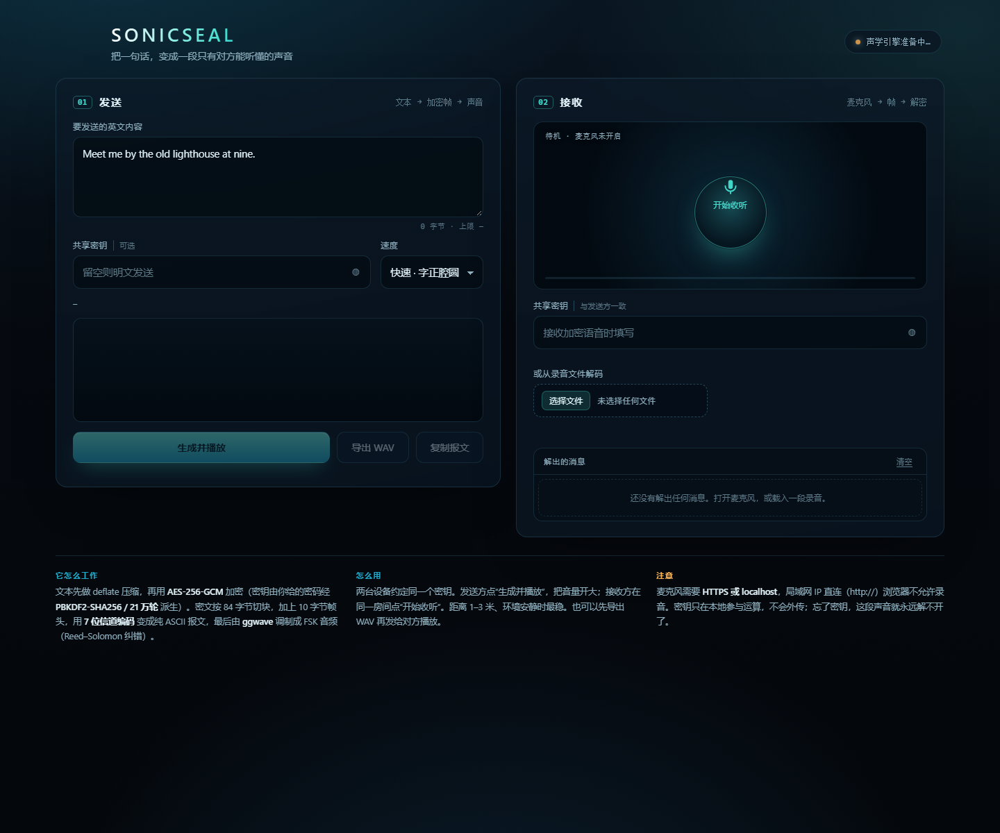

# SonicSeal · 声波加密机

把一句英文变成一段“响声”，只有拿着同一把密钥的人才能把它变回文字。

文本 → 压缩 → AES-256-GCM 加密 → 76 字节切块 → 7 位信道编码 → ggwave FSK 调制成声音 → 🔊
对方用麦克风收到声音 → 解调 → 解密 → 原文。



## 快速开始

```bash
node serve.cjs          # → http://localhost:8787
```

或者直接双击 `index.html`（`file://`）。区别：

| 方式 | 发送（播放 / 导出 WAV） | 麦克风接收 |
| --- | --- | --- |
| `http://localhost:8787` | ✅ | ✅ |
| `file://…/index.html` | ✅ | ❌ Chrome 禁止在 file:// 下录音 |
| `http://192.168.x.x`（局域网 IP） | ✅ | ❌ 非安全来源，同样禁止 |

浏览器只在 **HTTPS 或 localhost** 上给麦克风权限。想两台设备对传，最省事的做法是把站点放到任意 HTTPS 静态托管上；只想本机验证就开 `node serve.cjs`（同一台电脑上既放又收，可以自测）。

## 怎么用

1. 两台设备约定同一个**密钥**（比如 `harbor-lights-42`）。
2. 发送方输入英文，填密钥，点**生成并播放**，把音量开大。
3. 接收方填同样的密钥，点**开始收听**。
4. 距离 1–3 米、环境安静时最稳；解出的文字会出现在“解出的消息”里。

不想现场放音，也可以导出 WAV 发给对方，让对方用“从录音文件解码”载入——效果一样。

## 声音里到底装了什么

每一帧 122 字节，扩成 140 个 ASCII 字符交给 ggwave（它就是靠这个上限工作的）：

| 偏移 | 字节 | 含义 |
| --- | --- | --- |
| 0–1 | 2 | magics `'W'` `'S'` |
| 2 | 1 | 版本号（2） |
| 3 | 1 | 标志位：bit0 压缩过，bit1 已加密 |
| 4–7 | 4 | 消息 id（随机，用来归并同一段声音的多个分块） |
| 8 | 1 | 分块序号 |
| 9 | 1 | 分块总数（1–255） |
| 10–17 | 8 | salt：每条消息新生成的随机盐，PBKDF2 的盐 |
| 18.. | ≤104 | 正文：加密时是 nonce(12) + 密文 + tag(16)，否则是原始字节 |

- **密钥派生**：PBKDF2-SHA256，60 万轮，每条消息一个随机盐，按 (盐, 密钥) 缓存，派生一次即可。
- **加密**：AES-256-GCM，18 字节帧头（含盐）作为 AAD，所以改一个字节的序号或盐都会校验失败。
- **7 位信道编码**：ggwave 内部按 UTF-8 处理字符串，字节 ≥ 0x80 会被拆成两个字符。所以每 7 个字节打包成 8 个 `0x00–0x7F` 字符，122 字节正好 140 字符。
- **压缩**：`deflate-raw`，只有真的变小才用（英文正文压缩比一般 1.3–1.7×）。

### 速度与时长

| 模式 | 协议 | 每帧（140 字符） | 适用 |
| --- | --- | --- | --- |
| 标准 | `AUDIBLE_NORMAL` | ≈ 13.5 s | 最稳，环境差时用 |
| 快速（默认） | `AUDIBLE_FAST` | ≈ 9.3 s | 均衡 |
| 极速 | `AUDIBLE_FASTEST` | ≈ 5.0 s | 安静近距离 |

容量：正文上限 19380 字节，够几十条短句。

## 手机上用

页面本身就是 PWA：手机浏览器打开后「分享 → 添加到主屏幕」，之后从桌面图标进入即是全屏、无地址栏的 App 形态，断网也能打开（Service Worker 缓存了外壳）。

界面按手机优先重做：单列布局，顶部「发送 / 接收」分段切换，发送按钮固定在拇指区的浮条上，输入框 16px 避免 iOS 自动放大，并适配了刘海屏的安全区。桌面端在 980px 以上自动展开成双栏。

> 麦克风、Service Worker 都要求 **HTTPS 或 localhost**。用 `node serve.cjs` 在电脑上打开没问题；手机访问请用隧道或静态托管（见上面）。

## 安全边界（请务必读）

- 声音是**广播**：房间里任何人录下这段音频，就拿到了完整的密文。安全性完全取决于密钥强度，别用 `123456`。
- 没有密钥的人听到的只是一段带节律的哗哗声；他不一定能读出内容，但能看出“这里在传数据”。
- 密钥只在浏览器里参与运算，不上传任何服务器；本站没有任何后端。
- 忘掉密钥，这段声音就真的解不开了（没有后门，也没有弱密钥恢复）。
- 这是通信层面的隐私工具，不是隐写术：频谱上非常醒目。

## 开发

```bash
node test/run-tests.cjs      # 13 个用例：信封往返、错密钥、篡改、分块、压缩、4 种抗噪仿真
node test/make-wav.cjs "text" "passphrase" shots/fake-mic.wav fast   # 造一段“假麦克风”录音
node test/cdp.cjs http://127.0.0.1:8787/ 5000 out.png "1+1"          # 无依赖的 Chrome 自动化（截图 / 取日志 / 跑表达式）
```

用假麦克风跑完整接收链（headless Chrome）：

```bash
node test/make-wav.cjs "The eagle lands at midnight." "harbor-lights" "D:\run_keys\shots\fake-mic.wav" fast
EXTRA_FLAGS="--use-fake-ui-for-media-stream|--use-fake-device-for-media-stream|--use-file-for-fake-audio-capture=D:\run_keys\shots\fake-mic.wav" \
  node test/cdp.cjs "http://127.0.0.1:8787/" 5000 "" "$(cat test/eval-recv.js)"
```

测试覆盖到的东西（都跑过）：单块往返、错密钥拒收、密文篡改、帧头篡改（AAD）、明文模式、长消息分块重组、换了密钥后可重试并去重、压缩生效、以及在干净 / 带 65 ms 回声 / 带噪声 / 高频衰减四条声学链路上的 3 帧连发。

### 文件

```
index.html            单页界面（无构建，传统 <script>，file:// 也能跑）
assets/envelope.js    信封层：分帧、7 位编码、AES-GCM、压缩、重组（UMD，Node 可 require）
assets/app.js         Web Audio 播放、麦克风采集、声呐可视化、历史记录
assets/styles.css     界面样式（深水 / 声呐风）
vendor/ggwave.js      ggwave 0.4.0 单文件构建（wasm 以 base64 内嵌，无需额外 .wasm）
serve.cjs             极简静态服务器（localhost 算安全来源，麦克风可用）
test/                 测试与探针脚本
shots/                截图与测试音频
```

### 两个已知坑（都已在代码里绕过）

1. `ggwave.init()` 在浏览器里**第一次调用必定返回 0**，第二次才成功 —— `initModem()` 里带了重试。
2. 同一时刻只能有一个 modem 实例：`init` 两次会让前一个静默失效 —— 全站复用单实例，需要干净状态时 `free()` 再 `init()`。

---

## 电台版（ESP32-C3 + HC-12，脱离手机）

同一套帧格式，换一条传输链路：两块板子走 433 MHz，几十米内互发，不用手机也不用网。

```
英文文本 ──AES-256-GCM──► 帧 ──SLIP──► HC-12 ──433MHz──► HC-12 ──► 解密 ──► OLED
```

- 接线、烧录、配对的完整步骤在 **[firmware/README.md](firmware/README.md)**。
- 网页里的密钥框支持 `key:<64位hex>` 形式：填这个就走原始密钥，跳过 21 万轮 PBKDF2，
  与设备端完全对等（AES-256-GCM 本身一点没弱化）。
- 设备端在 PC 上可以完整自测，不需要硬件：

```bash
python test/verify-crypto.py   # AES-GCM 与 OpenSSL 逐字节比对
python test/cross-verify.py    # 设备帧 ↔ 浏览器帧 双向互通
python test/link-test.py       # 无线串口分帧（SLIP）
python test/node-test.py       # 两块"板"在内存里互相收发
python test/main-smoke.py      # 模拟硬件跑一遍 main.py
```

设备端代码在 `firmware/`：`main.py`（入口）、`config.py`（引脚/密钥）、
`lib/{ss_envelope,ss_gcm,aes_pure,ss_link,ss_node,ssd1306_min}.py`。
